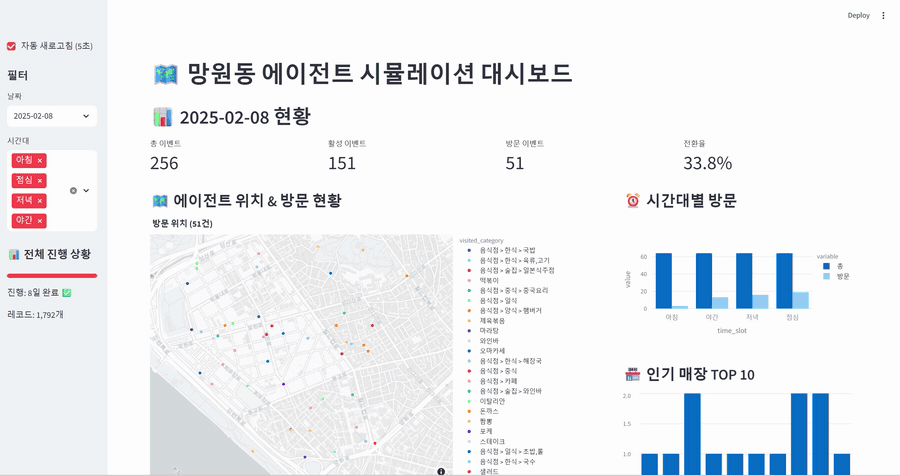
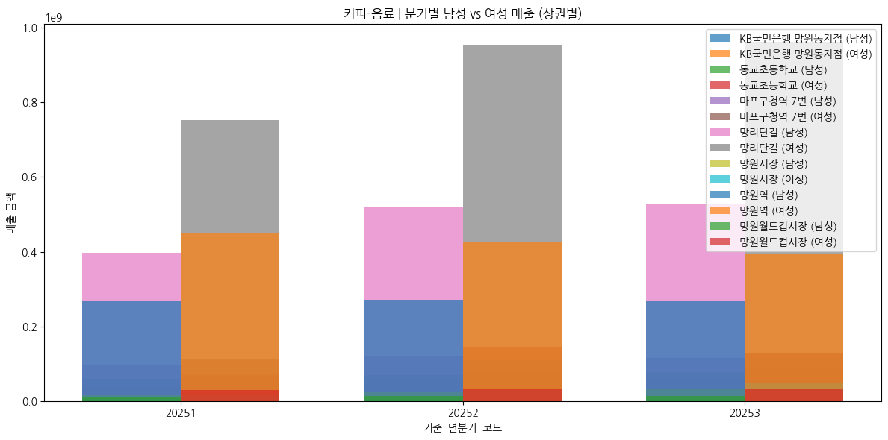
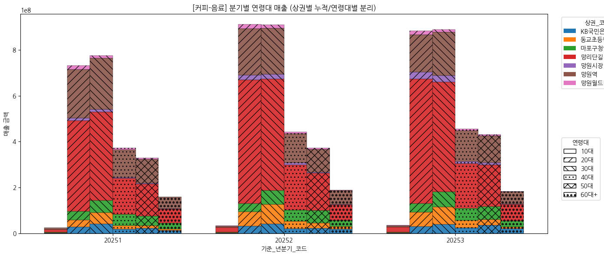
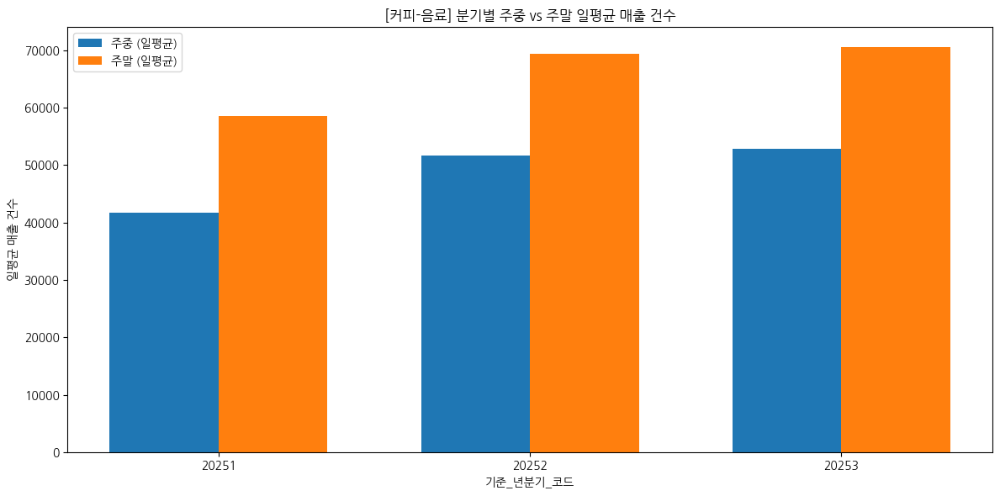

# 페르소나 기반 AI Agent를 통해 망원동 상권 시뮬레이션

> 소상공인이 매장 전략을 실제로 적용하기 전에, 실제 인구·상권 데이터로 만든 가상 소비자(AI Agent 160명)에게 먼저 실험해 보는 상권 시뮬레이터

> 이 저장소는 팀 프로젝트 원본 [khai-likelion/agent-sim](https://github.com/khai-likelion/agent-sim)을 **fork**해 README와 문서만 정리한 포트폴리오용 저장소입니다. 코드는 팀 전체의 결과물이며, 아래 [1. 저장소 소개](#1-저장소-소개-누구의-것인가)에 제가 담당한 범위와 팀원이 담당한 범위를 구분해 적었습니다.



<sub>2026-02-06 베이스라인 Streamlit 대시보드 화면 녹화 (에이전트 방문 로그, 에이전트 프로필 분석)</sub>

---

## 1. 저장소 소개 (누구의 것인가)

| 항목 | 내용 |
|---|---|
| 기간 | 2026.01 ~ 2026.02 (멋쟁이사자처럼 AI_NLP 심화과정 트랙 3기, 2025.12.22 ~ 2026.02.27) |
| 유형 | 부트캠프 팀 프로젝트 (최종 프로젝트) |
| 팀 구성 | 5명 — 이상준(상권 데이터 분석, 보행 시뮬레이션), 이채연(시뮬레이션 고도화, 대시보드), 조대흠(병렬화, 전략 전/후 비교), 이창현(데이터 로더, 리포트 설계), 이용직(페르소나 설계, 인구 EDA) |
| 내 역할 | 상권 매출 EDA와 LLM 인사이트 JSON 구축, OSMnx 도로망 기반 보행 시뮬레이션 설계·프로토타입 구현 |
| 원본 저장소 | [khai-likelion/agent-sim](https://github.com/khai-likelion/agent-sim) (조직 저장소, 저는 collaborator) |

### 내가 담당한 범위
- **상권 매출 데이터 EDA** — 업종·분기·상권별 매출을 성별, 연령대, 요일, 주중/주말로 나눠 분석 — 관련 코드: [`notebooks/sales_eda.ipynb`](notebooks/sales_eda.ipynb)
- **Qwen 기반 상권 인사이트 생성과 JSON 구조화** — 정형 매출 데이터를 LLM으로 정성 인사이트로 바꿔 Agent가 읽을 수 있는 JSON으로 구성 — 관련 코드: [`상권_1차_LM(JSON변환)_Final.ipynb`](https://github.com/khai-likelion/data-ETL/blob/main/%EC%83%81%EA%B6%8C_1%EC%B0%A8_LM(JSON%EB%B3%80%ED%99%98)_Final.ipynb) (data-ETL 저장소, 파일 업로드는 조대흠)
- **OSMnx 기반 Agent 보행 시뮬레이션** — 도로 그래프 위에서 Agent가 이동하는 프로토타입을 구현하고, 팀이 이를 모듈로 이식 — 관련 코드: [`Agent_Street.ipynb` (프로토타입)](https://github.com/groo030/agent-sim/blob/127fc75/Agent_Street.ipynb), [`src/data_layer/street_network.py`](src/data_layer/street_network.py) (이채연이 이식, [`9463dde`](https://github.com/groo030/agent-sim/commit/9463dde))
- **도로 기준 매장 인지 설계** — 반경 방식은 벽 너머 매장까지 인지하므로, Agent가 있는 도로망에서 연결된 거리 안의 매장만 인지하도록 설계 — 관련 코드: `StreetNetwork.get_nearby_stores` ([`street_network.py`](src/data_layer/street_network.py), 구현은 이채연)

**기타 기여** (커밋으로 확인되는 것)
- 생성형 Agent 시뮬레이션 초기 구현: 단계별 LLM 의사결정 체인, 매장 저장소, 대시보드 — [`c542b6a`](https://github.com/groo030/agent-sim/commit/c542b6a)
- Step5 행동 시스템과 LLM 기반 보행 속도 — [`750430c`](https://github.com/groo030/agent-sim/commit/750430c)
- 리뷰 코멘트 다양성 개선 (Step4), Step1 확률 기반 전환 — [`138af70`](https://github.com/groo030/agent-sim/commit/138af70)
- 인구통계 기반 Agent 생성 초기 시도 — [`efeaf48`](https://github.com/groo030/agent-sim/commit/efeaf48) (최종 버전은 `personas_160.json` 기반으로 대체됨)

### 팀원이 담당한 범위
- 이채연: 매장 796개 수집과 리뷰 요약, 3단계 의사결정 체인과 대시보드, 초기 위치·메모리(Memory Stream + Reflection), 매장 선택 최적화와 계층화 샘플링
- 조대흠: Param+Prompt 엔진, asyncio 병렬화, 전략 반영(StrategyBridge)과 전/후 비교 리포트
- 이창현: 데이터 로더와 Agent 생성 실험, X/Y 리포트 개념 설계
- 이용직: 행동 기반 페르소나 설계 논리, 인구 EDA

---

## 2. 문제 정의

- **누가, 어떤 상황에서 겪는 문제인가**: 소상공인은 컨설팅이나 리포트로 매장 전략(가격, 운영 변경)을 받아도, 실제로 적용해 보기 전에는 소비자가 어떻게 반응할지 알 수 없습니다.
- **왜 문제로 정의했는가**: 전략을 적용해 보는 것 자체가 비용과 위험이 큽니다. 설문은 응답자가 실제 행동과 다르게 답하는 한계가 있습니다.
- **목표**: 실제 인구·상권·리뷰 데이터로 소비자를 닮은 AI Agent를 만들고, 전략 적용 전/후 소비자 행동(방문, 평점, 리뷰)이 어떻게 달라지는지 비교해 보는 것입니다.

---

## 3. 해결 방법

### 전체 구조
```
공공데이터(인구·매출) + 카카오/네이버 리뷰
  → 매장별 JSON 720개 (EDA, LLM 인사이트)
  → 페르소나 160명 (상주 47 + 유동 113)
  → OSMnx 도로망 위 이동 (7일 × 4타임슬롯)
  → 단계별 LLM 의사결정 (외식 여부 → 업종 → 매장 → 평가 → 다음 행동)
  → 전략 적용 전/후 비교 → 대시보드
```

### 핵심 해결 사례 (문제 → 방법 → 결과)

**① 도로망 위에서 걷는 Agent**
- 문제 상황: 격자(H3)나 좌표 기반 이동은 Agent가 건물이나 한강을 통과합니다.
- 선택한 방법과 이유: OpenStreetMap 보행 도로망을 OSMnx로 만들고, Agent가 노드와 엣지를 따라 이동하게 했습니다. 다음 노드를 고를 때 직전 노드로 되돌아가는 것을 피하고, 나가는 길이 없으면 들어온 길로 돌아가며, 이웃이 전혀 없으면 이동을 멈추도록 `choose_next_node`를 설계했습니다.
- 결과: Agent가 항상 도로 geometry 위에서 움직입니다. 팀 모듈 이식 후 한강 위 다리 노드를 제거해 한강 위를 걷는 문제도 막았습니다 ([`2d3df03`](https://github.com/groo030/agent-sim/commit/2d3df03)). 2026-02-06 베이스라인 실행 로그 기준 도로 그래프는 6,187 노드 / 17,316 엣지입니다.
- 관련 커밋: [feat: add Agent_Street.ipynb](https://github.com/groo030/agent-sim/commit/127fc75), [feat: replace H3 grid with OSMnx street network](https://github.com/groo030/agent-sim/commit/9463dde)

**② 벽을 뚫지 않는 매장 인지**
- 문제 상황: 처음에는 Agent 주변 반경으로 매장을 찾으려 했는데, 그러면 벽 너머 다른 거리의 매장까지 인지하게 됩니다.
- 선택한 방법과 이유: 매장을 가장 가까운 도로 노드에 배치하고, Agent가 있는 노드에서 도로로 연결된 k-hop 이웃 노드의 매장만 후보로 삼도록 바꿨습니다. H3 k-ring 대신 그래프 이웃을 쓰는 방식입니다.
- 결과: `get_nearby_stores`로 구현됐습니다. 다만 최종 시뮬레이션 파이프라인은 이 함수를 호출하지 않고 반경과 카테고리 후보 필터를 쓰므로, 도로 기준 인지는 도로망 모듈 단계까지의 구현입니다 ([7장](#7-한계와-개선-방향) 참고).
- 관련 커밋: [feat: replace H3 grid with OSMnx street network](https://github.com/groo030/agent-sim/commit/9463dde)

**③ 정형 매출 데이터를 Agent가 읽는 인사이트로**
- 문제 상황: 업종·분기·상권별 매출 표는 숫자 덩어리여서 LLM Agent가 매장을 고를 때 바로 쓰기 어렵습니다.
- 선택한 방법과 이유: 매출을 성별, 연령대, 요일, 주중/주말로 EDA한 뒤, Qwen 기반 LLM으로 상권별 소비 패턴과 주요 고객층을 문장으로 만들고, 정량 지표와 함께 JSON으로 묶었습니다.
- 결과: 매장별 JSON 데이터셋(720개)의 상권 정보로 시뮬레이션에 사용됐습니다.
- 관련 코드: [`sales_eda.ipynb`](notebooks/sales_eda.ipynb), [`상권_1차_LM(JSON변환)_Final.ipynb`](https://github.com/khai-likelion/data-ETL/blob/main/%EC%83%81%EA%B6%8C_1%EC%B0%A8_LM(JSON%EB%B3%80%ED%99%98)_Final.ipynb)

| 커피-음료 성별 매출 | 커피-음료 연령대별 매출 | 커피-음료 주중/주말 일평균 매출 건수 |
|---|---|---|
|  |  |  |

### 핵심 코드
- [`Agent_Street.ipynb`](https://github.com/groo030/agent-sim/blob/127fc75/Agent_Street.ipynb) — 보행 프로토타입 (OSMnx 그래프, 1m/s 보행, Folium 시각화)
- [`street_network.py`](src/data_layer/street_network.py) — 도로망 로딩, Agent 이동, 매장 인지를 담당하는 팀 모듈
- [`action_algorithm.py`](src/simulation_layer/persona/cognitive_modules/action_algorithm.py) — 단계별 LLM 의사결정 (팀 공동 작성)
- [`run_before_after_sim.py`](scripts/run_before_after_sim.py) — 전략 적용 전/후 비교 시뮬레이션 (팀 공동 작성)

---

## 4. 성능 / 성과

내가 담당한 EDA, 보행, 매장 인지 작업에는 비교할 정량 baseline이 없어서 수치를 만들지 않았습니다. 아래는 프로젝트(팀) 전체의 개선 결과이며, 담당자를 함께 적었습니다.

| 비교 대상 (Baseline) | 개선 후 | 변화 | 담당 |
|---|---|---|---|
| 7일 시뮬레이션 소요 시간: 약 2시간 51분 (순차 LLM 호출, 호출당 1.5초 기준 추정) | asyncio 병렬 + Semaphore 적용, 2일·160명·동시 20 실측 4.7분 | 대폭 단축 | 조대흠 |
| 타깃 매장(돼지야) 후보 포함 확률: 0.7% | 10.8% (Softmax 가중 샘플링) | 약 15배 | 이채연 |
| 타깃 매장(돼지야) 7일 방문: 0건 | 13건 (계층화 샘플링) | +13건 | 이채연 |

- 평가 방법: 7일, Agent 160명, 동일 시드로 실행 결과 비교 (조건과 상세 표는 [에이전트-고도화-요약.md](docs/에이전트-고도화-요약.md))
- 소요 시간의 병렬화 실측치는 팀 노션 기록이며, 저장소 문서에는 순차 호출 추정치만 있습니다.
- 프로젝트 규모: 매장 720개, 페르소나 160명 (상주 47 + 유동 113), 7일 × 4타임슬롯

---

## 5. 기술 스택

| 분류 | 사용 기술 |
|---|---|
| Language | Python |
| Model / Framework | OpenAI GPT-4o-mini · Gemini Flash (시뮬레이션 LLM), Qwen (Hugging Face Transformers, 상권 인사이트), asyncio |
| Data / DB | Pandas, NumPy, JSON, OpenStreetMap(OSMnx, NetworkX, Shapely, pyproj), H3 |
| Visualization | Streamlit, Folium, Plotly |
| Tools | Google Colab (A100), GitHub, Jira |

---

## 6. 실행 방법

```bash
git clone https://github.com/groo030/agent-sim.git
cd agent-sim
pip install -r requirements.txt
cp .env.example .env          # LLM_PROVIDER, LLM_MODEL_NAME, LLM_API_KEY 설정 (config/settings.py 참고)

# 시뮬레이션 (비용·시간 예상치만 먼저 확인)
python scripts/run_generative_simulation.py --agents 160 --days 7 --target-store <매장명> --dry-run

# 전략 적용 전/후 비교
python scripts/run_before_after_sim.py --agents 160 --days 7 --target-store <매장명>

# 결과 대시보드
streamlit run scripts/dashboard.py
```

- 필요한 환경 변수: `.env.example` 참고 (실제 키는 올리지 않습니다)
- 데이터: 매장·리뷰 JSON(`data/raw/split_by_store_id/`)은 카카오맵·네이버 리뷰 등 재배포가 어려운 데이터를 포함해 저장소에 없습니다. 그래서 이 저장소만으로는 시뮬레이션을 그대로 재현할 수 없고, 구조와 코드를 확인하는 용도입니다.

---

## 7. 한계와 개선 방향

- 한계:
  - Agent가 페르소나를 잘 지켰는지 정량 평가를 하지 못했습니다. 평가 프레임워크는 설계만 했고 실행하지 못했습니다.
  - 팀에 상권 도메인 지식이 부족해 수준 높은 매출 증대 전략을 도출하지 못했습니다. 전략을 적용하자 타깃 매장 방문이 13건에서 1건으로 오히려 줄어, 전략 반영 방식은 추가 검증이 필요합니다.
  - 도로 기준 매장 인지(`get_nearby_stores`)는 최종 파이프라인에 연결되지 않았습니다. 최종 버전은 반경과 카테고리 후보 필터를 사용합니다.
  - 같은 세대 페르소나의 리뷰 말투가 비슷하게 나옵니다.
- 개선 방향: 페르소나 일관성을 정량 지표로 평가하고, 도로 기준 인지를 최종 파이프라인에 적용하며, 상권 전문가의 검토로 전략의 현실성을 확인합니다.

---

## 8. 라이선스 및 데이터 출처

- 라이선스: 지정하지 않음 (팀 합의 필요)
- 데이터 출처: 서울 열린데이터광장(인구·상권 매출), OpenStreetMap(ODbL), 카카오맵·네이버지도 매장 리뷰 (원본 데이터는 저장소에 포함하지 않음)
- 참고한 오픈소스 / 논문: Park et al., *Generative Agents: Interactive Simulacra of Human Behavior* (Stanford, 2023), OSMnx

---

## Contact
- 이상준 / GitHub: [groo030](https://github.com/groo030)
